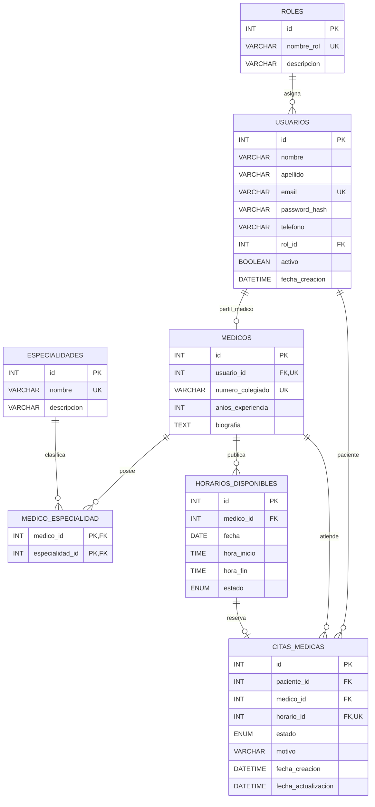

# DER — Sistema de Citas Médicas (Fase 1)

El modelo cubre únicamente las entidades requeridas para la Fase 1: usuarios/roles, especialidades/médicos, horarios disponibles y citas médicas. La relación médico–especialidad es N:M y se normaliza mediante `medico_especialidad`.

## Reglas de integridad principales

- `usuarios.email` es único y se utiliza como identificador de login.
- `medicos.usuario_id` es único, por lo que un usuario solo puede tener un perfil de médico.
- `medico_especialidad` resuelve la relación N:M sin atributos redundantes.
- `horarios_disponibles` evita duplicar el mismo inicio de bloque para un médico en una fecha.
- `hora_fin > hora_inicio` se valida con `CHECK`.
- `citas_medicas.horario_id` es único, impidiendo reservar dos citas sobre el mismo bloque.
- Los cruces de horarios más complejos y las reglas transaccionales se dejan para Fase 2, como indica el cronograma.
